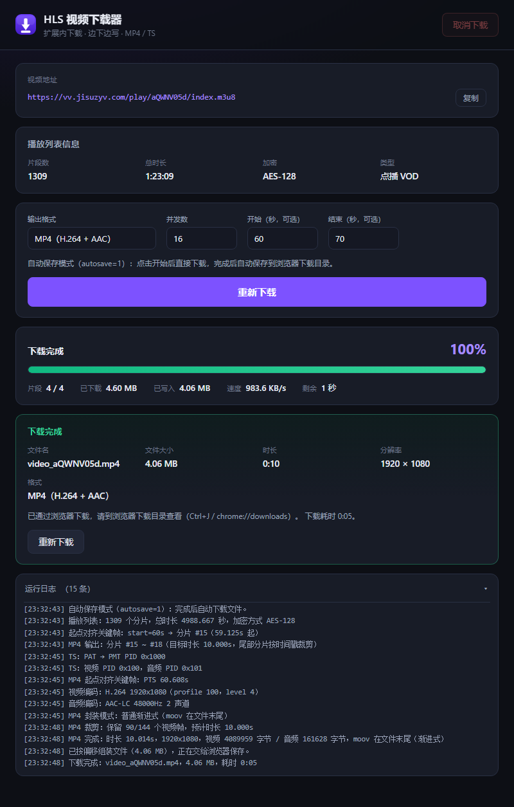

# 视频下载器（浏览器扩展 · Chrome / Edge · Manifest V3）

在浏览器里直接下载网页播放的视频，纯扩展内完成、**不需要安装本地服务端**：

- **HLS（m3u8）**：自动检测 → 并发下载分片 → AES-128 解密 → **直接封装为普通 MP4**（H.264 + AAC，默认）或保留 TS 原始流。
- **B 站（v1.1）**：整段 MP4 直存；1080P 走 DASH 音视频合并，清晰度可选。
- **抖音（v1.2）**：读页面自己的数据拿播放地址与多档码率，直接存 MP4。
- **腾讯视频（v1.3）**：走官方 `getinfo` 接口拿整段 MP4 与多档清晰度；**仅免费 / UGC 内容**，版权内容（DRM）明确拒绝。
- **优酷（v1.4）**：在优酷页面上下文里调 `ups` 接口拿 m3u8，走 HLS 分片 + AES-128 下载；风控 / 会员内容明确提示。

- 纯前端、Manifest V3、无远程代码 / 无 CDN / 无 eval / 无 wasm。
- 下载时边下边写盘（File System Access API），不会把整部视频读进内存。
- 支持手动粘贴链接；HLS 支持只下载指定时间段；支持取消下载并清理半成品。

**版本**：1.4.0（当前支持：通用 HLS、B 站、抖音、腾讯视频、优酷）

> 1.4.0：新增**优酷**支持（v.youku.com）。优酷给的是 HLS（m3u8 + AES-128），因此复用通用 HLS 核心下载；
> 播放信息走 `ups.youku.com/ups/get.json`（`utid` 用 `log.mmstat.com` 的 cna，参数与 yt-dlp 一致）。
> 实测本机 IP 被优酷风控恒定拒绝（`-6004`），所以解析优先**在优酷页面上下文里发请求**
> （带用户 Cookie 与真实网络出口），直连只作回退；错误码 `-6004/-6005/-6003` 都翻译成人话。
> 会员 / 付费 / 地区限制内容明确拒绝。
>
> 1.3.0：新增**腾讯视频**支持（v.qq.com）。走官方 `getinfo` 接口拿播放信息：
> 免费 / UGC 视频（`/x/page/<vid>.html`、`/x/cover/<专辑>/<视频>.html`）直接返回普通 MP4，
> 匿名最高 720P，清晰度可在 270P / 480P / 720P 间切换；
> **剧集 / 电影 / 综艺等版权内容走 DRM 加密（`vi.drm=1`），扩展明确拒绝，不做解密与绕过**。
> 实测腾讯 CDN 不校验 Referer，因此不需要额外 DNR 规则；接口对频率敏感（93.2 限流），
> 已做全局节流 + 退避重试。踩坑记录：`vi.encryption` 字段在免费视频上也有值，不能拿来判断 DRM。
>
> 1.2.3：支持**个人主页 / UP 主主页 / 历史记录页**里的视频下载。根因是这类页面 URL 里没有作品号
> （如 `/user/MS4wLjAB...`、`/user/self?showTab=history`），此前直接识别为「非抖音内容页」返回 null。
> 现在统一识别为 `page` 类型：取**页面上正在播放的那条**（按播放地址/时长对齐捕获缓存）；
> 同时「最近捕获」兜底只在信息流（feed）允许——主页这类页面里没有"当前正在播"的概念，
> 猜最近一条容易拿错作品；页面没在播时会明确提示「先点开目标视频再回来点开始下载」。
>
> 1.2.2：再修一版「滑动切换后识别不到」。根因是捕获范围只覆盖了 `aweme/detail`，而信息流走的是
> `tab/feed` 这类**批量接口**；现在对所有 `/aweme/vN/...` 响应做通用扫描。判定当前视频也改成
> 「地址路径 → 播放时长 → 页面文案」三级对照，URL 上的旧 `modal_id` 不再压过画面。
>
> 1.2.1：修复抖音「切换视频后下不了」——信息流/精选页改为**捕获页面自己请求的作品详情**（document_start 注入，
> 按 aweme_id 缓存），并修掉把「同路径不同 modal_id」当成同一页的标签页复用逻辑；
> 普通推荐页（地址不变）也能识别当前正在播放的那条。
>
> 1.2.0：新增**抖音**支持。抖音没有可用公开接口（服务端还返回 JS 挑战页），
> 因此改为**读页面自己的数据**（`_ROUTER_DATA` → `RENDER_DATA` → `<video>.currentSrc` 三级兜底），
> 拿到作品标题、作者、多档码率地址；下载走 DNR 补 `Referer` 后直连存 MP4。

> 1.1.1 / 1.1.2：弹窗只有**一张来源卡**，按当前标签页的链接类型换内容——
> 命中 B 站时标题变「检测到 B站视频」、列表里换成这条视频页链接（可复制、可选中）；
> 其它页面仍是「检测到的 M3U8」+ 候选列表。
>
> 1.1.3：修复 B 站页面没有角标的问题——角标规则统一为「m3u8 候选数优先，站点视频页计 1」；
> 同时补上稍后再看 / 收藏夹 / 活动页等 `/list`、`/medialist` 形式播放页的识别（视频号在 query 里）。
>
> 1.1.4：B 站清晰度上限从 720P 提到 **1080P**——播放地址改为在 B 站页面上下文里请求，带上浏览器里的登录态；
> 未登录仍是 720P。界面上会直接写明「本次清晰度」以及是不是受未登录限制。
>
> 1.1.6：**支持 1080P**。查清了 720P 的真实原因——durl（整段 MP4）通道本身封顶 720P，
> 1080P 只在 DASH 通道且音视频分离；新增 fMP4 解复用 + mp4-muxer 合并（边下边写，不占内存），
> 清晰度下拉按「真实存在的 H.264 轨道」列出，选 1080P 就自动走合并。
>
> 1.1.5：补上 **WBI 签名（w_rid）**——B 站对高清晰度要求签名，只带 Cookie 不够，这也是 1.1.4 仍停在 720P 的原因；
> 同时下载页新增**清晰度下拉**：接口给几档就列几档，切换后即时重新解析（1080P 以上会标明「需 DASH，暂不支持」）。

---

## 一、安装（加载已解压的扩展程序）

1. 打开 Chrome 或 Edge，地址栏进入 `chrome://extensions`（Edge 为 `edge://extensions`）。
2. 打开右上角的 **“开发者模式”** 开关。
3. 点击 **“加载已解压的扩展程序”**，选择本项目里的 **`浏览器扩展/`** 目录（就是包含 `manifest.json` 的那一层）。
4. 扩展列表中出现“HLS 视频下载器”即安装成功；建议把它固定到工具栏（拼图图标 → 图钉）。

> 安装后如果修改了扩展文件，回到 `chrome://extensions` 点击该扩展卡片上的 **刷新（↻）** 按钮即可生效。

**环境要求**：Chrome / Edge 版本 ≥ 116（Manifest V3 + `chrome.storage.session`）。推荐使用较新的正式版。

---

## 二、使用步骤

### 1. 自动检测下载

1. 在视频网站正常播放视频（让页面真正请求到 `.m3u8` 播放列表）。
2. 点击工具栏上的扩展图标，弹窗会列出当前标签页检测到的 m3u8 链接；扩展图标角标上的紫色数字就是候选数量。
3. 在列表中选中一条（默认选中最新一条），可点“复制”。
4. 选择 **输出格式**（MP4 推荐 / TS）和 **并发数**（默认 16，网络好可调高，1–64）。
5. 点击 **“开始下载”**，会打开扩展内的下载页面。
6. 下载页面先自动解析播放列表，显示片段数、总时长、是否加密、清晰度档位；
   点击 **“选择保存位置并开始下载”**，在系统保存对话框里选择位置后开始下载。
7. 下载过程中可以查看进度、速度、剩余时间、日志；随时可以点 **“取消下载”**。
8. 完成后会显示结果卡（文件名、大小、时长、分辨率、保存位置提示），可点“重新下载”。

### 2. 手动粘贴链接下载

在弹窗的“手动输入”里粘贴任意 m3u8 地址 → 点 **“解析”** 先确认信息（片段数 / 时长 / 加密 / 清晰度）→ 点 **“开始下载”**。

### 3. B 站视频（v1.1 新增）

1. 打开任意 B 站视频页（`https://www.bilibili.com/video/BVxxxxxxx`，支持 `?p=2` 指定分 P、`b23.tv/xxx` 短链、`av` 号）。
2. 点击工具栏图标：列表卡标题变成 **「检测到 B站视频」**，列表里就是这条视频页链接（可复制、可选中），扩展图标右下角显示 **1**。
3. 下载页自动解析：标题、UP 主、清晰度、文件大小、时长；确认后点 **「选择保存位置并开始下载」**。
4. **清晰度下拉（v1.1.6）**：下载页有「清晰度」选择框，列出的都是**真的能下到的档位**——
   未登录通常只有 720P / 480P / 360P，登录后有 1080P。切换后立即重新解析，文件大小与文件名一起刷新。
   选 1080P 时会自动走「视频轨 + 音频轨合并」（下载页会提示），低于 720P 的档位能整段直存。
5. 文件按 `标题_BV号[_P2]_1080P.mp4` 命名，保存位置由你在系统对话框里选择。

也可以不打开 B 站页面：在弹窗「手动输入」里粘贴 B 站视频链接 → 点「解析」→ 点「开始下载」。

**B 站下载是怎么走的**（值得知道，因为它决定了失败时的表现）：

| 环节 | 做法 |
| --- | --- |
| 取播放地址 | 公开接口 `x/web-interface/view` + `x/player/wbi/playurl`（带 WBI 签名），同时要 DASH 与 durl 两种格式 |
| 清晰度 | durl 通道**封顶 720P**（这是 1.1.5 之前只有 720P 的真正原因）；1080P 只在 DASH 里。两件事都要：**WBI 签名** + **在 B 站页面上下文里请求**（带登录态） |
| 1080P 下载 | DASH 的视频轨、音频轨分开取，边下边用 mp4-muxer 合并成一个 MP4（不落临时文件、不占整片内存） |
| 直连下载 | 扩展页直接 fetch，配合 `declarativeNetRequest` 静态规则给 CDN 请求补上 `Referer: https://www.bilibili.com`（B 站 CDN 强校验 Referer，缺了就是 403） |
| 直连被拒时 | 自动降级：在任意 B 站标签页（没有就后台开一个 `https://www.bilibili.com/`）里用页面上下文分块取字节，天然带正确 Referer，再回传给扩展写盘 |

不支持的 B 站内容：**番剧/影视等 PGC 页面**（`/bangumi/`）、付费课程、充电专属、SAMPLE-AES / DRM 加密内容。
这些要么需要登录与付费，要么属于版权保护内容，扩展不会绕过。

### 4. 抖音视频（v1.2 新增，v1.2.3 支持主页 / 历史记录）

1. 打开抖音网页版的作品页（`https://www.douyin.com/video/<id>`，也支持 `/note/<id>`、`v.douyin.com` 短链、
   `?modal_id=<id>` 这类浮层地址）；**精选页 / 推荐页的信息流也可以**——直接停在你想下的那条上即可；
   **个人主页 / UP 主主页 / 历史记录页**也可以（v1.2.3）——先把目标视频点开让它开始播放，再回来点下载。
2. 点工具栏图标：列表标题变成 **「检测到 抖音视频」**，列表里是作品链接（信息流则显示“当前信息流”，
   主页 / 历史记录显示“当前页面”），图标右下角显示 **1**。
3. 点「开始下载」→ 下载页读页面自己的数据，解析出标题、作者、可选清晰度（按码率分档）、时长与文件大小。
4. 选好清晰度 → 选保存位置 → 下载。产物是 `标题_作品号.mp4`。

**为什么是「读页面」而不是调接口**

抖音的服务端对脚本请求返回 JS 挑战页，`aweme/v1/web/aweme/detail` 还需要 `a_bogus` 签名。
所以扩展不去逆向签名，而是让**页面自己把数据交出来**：

| 顺序 | 来源 | 说明 |
| --- | --- | --- |
| 1 | 页面自己请求到的 `aweme/detail` 响应 | `src/page/douyin-capture.js` 在 `document_start` 注入 MAIN world，把页面拿到的详情按 `aweme_id` 缓存。**信息流、精选页、点开推荐视频都靠它**——不依赖播放，也不依赖地址变化 |
| 2 | `window._ROUTER_DATA` | 作品页 SSR 的数据，含 `bit_rate` 多档码率 |
| 3 | `<script id="RENDER_DATA">` | 老版页面的数据块（URI 编码的 JSON） |
| 4 | 正在播放的 `<video>.currentSrc` | 最后兜底，只有当前这一档、且没有标题与大小 |

**滑动切换后为什么以前识别不到（v1.2.2 修复）**：

信息流的作品**不是**逐条走 `aweme/detail`，而是 `tab/feed` 这类**批量接口**返回 `aweme_list`。
v1.2.1 只监听了 `detail|post|related`，于是滑动时一条都没捕获到；`<video>.currentSrc` 又要求视频正在播
（后台标签页被禁自动播放），两条路一起断，就表现为「只有第一条能识别」。

现在的做法是三层：

| 层 | 做法 | 解决的问题 |
| --- | --- | --- |
| 捕获 | 对所有 `/aweme/vN/...` 的 JSON 响应做通用扫描，凡是含 `video.play_addr` 的对象都按 `aweme_id` 缓存 | 信息流批量接口、弹层切换都能覆盖 |
| 判定 | 用「播放地址路径 → 播放时长（±0.8s）→ 页面文案」给缓存里的作品打分，取最高分 | URL 上的 `modal_id` 停在旧值时，以**画面**为准 |
| 兜底 | 实在认不出是哪一条，就直接下当前画面正在播的那个地址（标题取页面文案） | 宁可少点元数据，也要能下 |

**注意**：`content_scripts` 只在页面**新加载**时注入。为了不让旧页面失效，解析前会用
`scripting.executeScript({ files })` 把捕获脚本**按需补注入**一次（脚本自带幂等守卫）。
即便如此，浏览器里已打开的旧页面在补注入之前发生的请求是拿不到的——更新扩展后建议刷新一次抖音页。


**不支持**：直播间、图文作品里的图片、需要登录才能看的私密/付费作品。
抖音的播放地址有签名与时效，**过期后会 403**；此时重新打开页面解析一次即可。

### 5. 腾讯视频（v1.3 新增）

1. 打开腾讯视频的**免费视频播放页**：`https://v.qq.com/x/page/<视频号>.html`，
   或剧集里具体某一集的 `https://v.qq.com/x/cover/<专辑号>/<视频号>.html`。
2. 点工具栏图标：标题变成 **「检测到 腾讯视频」**，列表里显示视频号，图标右下角显示 **1**。
3. 点「开始下载」→ 扩展调用腾讯的 `getinfo` 接口拿播放地址 → 选清晰度（270P / 480P / 720P）→ 保存。
   产物是 `标题_视频号.mp4`，H.264 + AAC 整段 MP4，不需要重新封装。

**能力边界（先说清楚）**：

| 内容类型 | 是否支持 | 原因 |
| --- | --- | --- |
| UGC / 免费短视频（`/x/page/`、`/x/cover/<专辑>/<视频>`） | ✅ 支持，匿名最高 720P | `getinfo` 直接给普通 MP4（`drm=0`） |
| 剧集 / 电影 / 综艺（VIP 或版权内容） | ❌ 不支持 | 源站走 DRM 加密（`vl.vi[0].drm=1`），扩展不做解密也不绕过 |
| 专辑页（`/x/cover/<专辑号>.html`，地址里没有视频号） | ❌ 提示先点开某一集 | 该页面本身不指定视频，页面数据是前端异步渲染的，拿不到可靠的作品号 |
| 被切成多段的超长视频 | ❌ 明确提示暂不支持 | 实测常见视频均为单文件；遇到多段会直接说明，不会下出一个坏文件 |

**为什么不需要 DNR 规则 / 标签页代理**：实测腾讯 CDN（`*.tc.qq.com`）**不校验 Referer**，
带与不带 Referer 都返回 200，所以扩展直接 fetch 即可；播放地址统一用 https（同一路径 https 可用），
原始 http 地址留作备用镜像。

**接口节流**：`getinfo` 对短时间内的重复请求很敏感，会返回 `93.2`「账号检测到可疑行为」。
扩展做了全局节流（两次请求至少间隔 700ms）+ 命中 93.x 时退避 2 秒重试一次；
切换清晰度时会再请求一次（每一档的文件名不同）。

### 6. 优酷（v1.4 新增）

1. 打开优酷播放页：`https://v.youku.com/v_show/id_<视频号>.html`（移动端 `m.youku.com/...` 也行）。
2. 点工具栏图标：标题变成 **「检测到 优酷视频」**，显示视频号。
3. 点「开始下载」→ 扩展先在**优酷页面上下文里**请求 `ups` 播放接口（带你的 Cookie 与真实网络出口），
   拿到 m3u8 播放列表 → 选清晰度 → 下载时并发拉分片、按需 AES-128 解密、封装成 MP4。

**为什么优酷要特殊处理**：它的播放接口 `ups.youku.com/ups/get.json` 对匿名 / 陌生设备的风控非常严。
本机实测（2026-11-16）无论怎么换 `utid` / `ccode`，都恒定返回：
`-6004 该账号检测到有可疑违规、侵权等行为，已限制播放`。
所以扩展不在扩展页里裸调接口，而是**在你自己打开的优酷页面里发同一个请求**——
Cookie、Referer、网络出口都和真实播放一致，成功率高得多；直连只作为回退（会自己取 `log.mmstat.com` 的 cna 当 `utid`）。

| 情况 | 表现 |
| --- | --- |
| 页面能正常播放该视频 | 正常解析、出清晰度、可下载 |
| 接口返回 `-6004`（风控） | 明确提示「请先在浏览器里正常播放这个视频，再点下载；必要时换网络 / 登录」 |
| 接口返回 `-6005`（未登录） | 提示先登录优酷 |
| 会员 / 付费 / 地区限制 | 明确说明不支持，不产生下载文件 |

**格式**：优酷给的是 HLS（m3u8），分片多为 TS + AES-128，由通用 HLS 核心处理；
因此下载页的「分片」栏会显示 `HLS（m3u8）`，而不是「整段 MP4」。节目本身带 DRM 的内容不做解密、不做绕过。

### 7. 只下载片段区间（可选）

下载页面支持填写“开始（秒）”和“结束（秒）”，例如 `60` / `70` 表示只下载 01:00–01:10 的内容；
留空表示下载整部视频。MP4 输出会按时间戳裁剪到该区间（**仅 HLS 支持；B 站是整段 MP4，不做裁剪**）。

### 8. 下载页 URL 参数（高级 / 自动化）

下载页 `downloader/downloader.html` 支持以下查询参数：

| 参数 | 说明 | 默认 |
| --- | --- | --- |
| `url` | m3u8 地址（必填） | — |
| `format` | `mp4` 或 `ts` | `mp4` |
| `concurrency` | 并发数 1–64 | `16` |
| `start` / `end` | 只下载指定秒区间 | 整部 |
| `title` | 页面标题（仅展示用） | 空 |
| `autosave` | `1` = 跳过保存对话框，完成后用浏览器下载（自动化测试用） | `0` |

例如：

```
chrome-extension://<扩展ID>/downloader/downloader.html?url=https%3A%2F%2Fexample.com%2Findex.m3u8&format=mp4&concurrency=16&autosave=1
```

---

## 三、保存位置说明

- **默认（推荐）**：点击开始后会弹出系统“另存为”对话框（File System Access API），
  由你选择目录和文件名；下载过程中**边下边写入该文件**，不占内存。
- **`autosave=1` 或浏览器不支持 File System Access API 时**：文件先缓冲在内存中，
  完成后通过 `<a download>` 交给浏览器下载，保存到浏览器的默认下载目录
  （可在 Chrome 设置里查看，快捷键 `Ctrl+J` 打开下载内容页）。
- 完成后的结果卡会提示本次文件的保存方式；使用“另存为”时文件名以你选择的为准。
- 扩展**不申请 `downloads` 权限**，不会静默往你的硬盘里写文件。

**默认文件名规则**：`video_<视频标识>.<mp4|ts>`。例如
`https://vv.jisuzyv.com/play/aQWNV05d/index.m3u8` → `video_aQWNV05d.mp4`。
视频标识取 m3u8 路径中 `index.m3u8` 前的一段目录名（没有上级目录时退回域名），只保留字母、数字、下划线、连字符。

---

## 四、常见问题（FAQ）

**Q1：弹窗里检测不到 m3u8 链接？**
A：先让页面真正播放视频（部分网站只有点击播放后才请求 m3u8）；也可以手动粘贴链接。
如果链接是 `blob:` 或经过 MSE 二次封装的，可能拿不到原始 m3u8，可尝试在开发者工具 Network 面板搜索 `.m3u8` 后手动粘贴。

**Q2：下载报错 403 / 401，或提示网络错误？**
A：部分站点对分片请求校验 `Referer` / `Cookie` / 签名有效期。本扩展在扩展页面内发请求，
会带上你当前浏览器的 Cookie，但不会自动伪造 `Referer`；如果站点强校验，请稍后重试或使用站点允许的方式。
另外，m3u8 地址或分片地址带时效签名时，过期后需重新获取链接。

**Q3：提示证书错误 / 连接不安全？**
A：扩展页面会像普通网页一样校验证书。请确认站点证书有效；不要为了绕过而关闭系统校验。

**Q4：下载速度慢 / 进度卡住？**
A：可以适当调高并发数（如 24–32），但过高可能被服务器限速或拒绝；如果某个分片一直失败，
扩展会按指数退避自动重试若干次，仍失败会给出中文错误信息。

**Q5：点“取消下载”后文件还在吗？**
A：取消会中止所有正在进行的请求，并丢弃已写入的数据（“另存为”模式下会中止写入）。
结果会在界面显示 **“已取消”**，并清理未完成的半成品。

**Q6：为什么只支持 VOD（点播）的 AES-128 加密？**
A：直播流没有 `#EXT-X-ENDLIST`，无法确定结尾；SAMPLE-AES / DRM（Widevine 等）属于受保护内容，本扩展不支持且不会绕过 DRM。

**Q7：安装时提示权限很多（读取和更改所有网站上的数据）？**
A：这是 `host_permissions: ["<all_urls>"]`，用于在扩展页面跨域请求任意站点的 m3u8 与分片、以及在 B 站页面里取视频字节，是下载功能的必要条件。
扩展只在检测 m3u8 时被动记录链接，不会注入页面、不修改网页内容。

**Q7b：`declarativeNetRequest`、`scripting`、`content_scripts` 权限是干什么的？**
A：都服务于具体站点：

- `declarativeNetRequest` + `rules/{bilibili,douyin}-referer.json`：给发往 B 站 / 抖音 CDN 的请求补 `Referer`。
  规则是**静态、只改请求头**，不改地址、不重定向、不屏蔽任何请求，作用范围仅限规则里列出的域名。
- `scripting`：到标签页里取数据——
  B 站是直连被拒时分块取字节、以及在页面里请求 playurl（带登录态 + WBI 签名）；
  抖音是在页面里读作品详情。
- `content_scripts`：只有一条，作用域**仅限 douyin.com**（`world: MAIN`，`document_start`），
  内容是 `src/page/douyin-capture.js`：把页面自己请求到的 `aweme/detail` 响应按作品号缓存下来。
  它**不发请求、不改请求、不读写页面 DOM**，只做数据留存。

**Q8：B 站只能下到 720P？**
A：不是。720P 是**未登录**时接口给的上限。扩展会把 `playurl` 请求**放在 B 站页面上下文里发**，
请求天然带上你浏览器里的 B 站登录态，因此：

- 未登录 → 720P / 360P；
- 已登录（免费账号）→ 最高 **1080P**；
- 大会员的 1080P+ / 4K / HDR / 杜比 → 走 **DASH 分离轨道**（音视频两条），当前版本还不能合并，会明确提示。

扩展**不读取、不保存、不转发**任何 Cookie：请求由页面自己发出，扩展只接收“播放地址”这段 JSON。

**Q9：为什么用命令行 `--load-extension` 启动 Chrome 时扩展没加载？**
A：Chrome 137+ 的正式版出于安全考虑限制了命令行加载扩展（`--disable-extensions-except` 会被忽略），
自动化测试请使用 **Chrome for Testing**；普通用户手动“加载已解压的扩展程序”不受影响。

**Q10：下载 MP4 后播放器能播吗？**
A：默认输出是普通渐进式 MP4（moov 在文件末尾），Chrome / Edge / VLC / PotPlayer / ffmpeg 均可正常播放。
如果目标站点原始编码不是 H.264 + AAC，封装结果可能无法播放，此时可改用 TS 原始流输出。

---

## 五、已知限制

**通用**

- **站点视频**：B 站、抖音、腾讯视频、优酷的**免费内容**；各站的具体限制见下方分站说明。
- **不支持**：DASH（mpd）直链、blob: MSE 私有协议（后续版本再扩）。
- 需要 `host_permissions: ["<all_urls>"]` 才能跨域获取播放列表、分片与站点视频字节。
- 浏览器内存/磁盘限制：`autosave`（内存 Blob）模式会在完成后按偏移组装完整文件（峰值内存约为文件大小的 2 倍），
  不适合超长视频；长视频建议使用“另存为”流式写入。
- 扩展不提供任何绕过付费/版权保护的能力，请仅下载你有权保存的内容。

**HLS**

- **仅支持 VOD**（存在 `#EXT-X-ENDLIST`）；直播流可能无法完整下载。
- 加密仅支持 **AES-128**（`#EXT-X-KEY:METHOD=AES-128`）；**SAMPLE-AES / DRM 不支持**。
- 输出为 MP4 时要求源流为 **H.264 视频 + AAC 音频**（TS 分片）；其它编码请选 TS 输出。
- 不支持需要特殊 `Referer` / 自定义请求头强校验的站点。

**B 站（v1.1）**

- 画质上限 **1080P**：1080P 走 DASH 合并；1080P+ / 4K / HDR / 杜比虽然也是 DASH，但大多只有 HEVC/AV1 轨道，
  当前合并器只支持 **H.264**，所以这些档位不会出现在下拉里。
- 清晰度取决于登录态：未登录 720P（durl 封顶），登录后 1080P。扩展不读取、不保存 Cookie，
  只是把接口请求放到 B 站页面里发，让浏览器自己带 Cookie。
- 极少数超长视频的 durl 会被拆成多段；此时会自动改走 DASH 合并，不再报错。
- 不支持 **番剧/影视（PGC）**、付费课程、充电专属、互动视频、SAMPLE-AES/DRM 内容。
- 不支持按时间段裁剪（源文件是整段 MP4，不做重封装）。

**抖音（v1.2）**

- 依赖**页面自身的数据**：优先用 `document_start` 捕获的 `aweme/detail` 响应，其次 `_ROUTER_DATA` /
  `RENDER_DATA`，最后才用正在播放的 `<video>.currentSrc`。
- 信息流页（首页推荐 / 精选）没有地址变化，取的是「当前画面正在播的那一条」；若视频尚未开始播放、
  页面也没请求过详情，会提示「页面里没有找到视频信息」——先点一下播放再重试即可。
- 解析时会在后台打开（或复用）一个该作品的标签页；关掉它不影响已开始的下载。
- 播放地址带时效，**过期后 403**：重新解析一次即可。
- 只支持单个作品；不支持直播间、图集里的图片、合集批量、私密/付费作品。
- 抖音图片/视频都可能有水印，扩展**不做去水印**（那属于篡改他人内容）。
- 直连被 CDN 拒绝并降级到标签页代理时，速度受 base64 传输影响，约为直连的 1/2～1/3；
  代理模式需要至少一个可用的 B 站标签页（没有会后台打开一个）。

**腾讯视频（v1.3）**

- **仅支持免费 / UGC 内容**：剧集、电影、综艺等版权内容走 DRM 加密（`vl.vi[0].drm=1`），
  扩展**不做解密、不做绕过**，会直接给出明确提示。
- 匿名最高 **720P**（接口匿名只给 270P / 480P / 720P 三档）；不读取登录态。
- 专辑 / 剧集页（`/x/cover/<专辑号>.html`，地址里没有视频号）需要先点开具体某一集。
- 若视频在源站被切成多段，当前版本会明确提示暂不支持（实测常见视频均为单文件）。
- 接口有频率限制（93.2），连续快速解析可能被临时拒绝——等十几秒再试。
- 播放地址带时效（`vkey`），**过期后 403**：重新解析一次即可。

**优酷（v1.4）**

- **依赖页面上下文**：解析时会在后台打开（或复用）一个 youku.com 标签页，在页面里请求 `ups` 接口。
  这是为了绕开优酷对陌生设备的风控（本机实测恒返回 `-6004`）。
- 接口给的是 **HLS**：分片多为 TS + AES-128；SAMPLE-AES / DRM 会明确报错。
  极少数节目若用 fMP4 播放列表（`#EXT-X-MAP`），当前下载核心只告警、产物可能不完整（优酷常见的是 TS，实测未遇到）。
- 会员 / 付费 / 地区限制内容不支持；被风控时按提示先播放一次或换网络。
- 只支持单个视频页；不支持直播、专辑批量。

---

## 六、目录结构

```
浏览器扩展/
├─ manifest.json          # MV3 清单：权限、SW、popup、图标、DNR 规则集
├─ background.js          # Service Worker：webRequest 检测 m3u8、角标、消息 API、设置
├─ rules/
│  ├─ bilibili-referer.json  # 静态规则：给 B 站 CDN 请求补 Referer（只改请求头）
│  ├─ douyin-referer.json    # 静态规则：给抖音 CDN 请求补 Referer
│  └─ youku-referer.json     # 静态规则：给优酷 CDN 请求补 Referer
├─ popup/                 # 工具栏弹窗：来源卡（m3u8 / B站 / 抖音 / 腾讯链接，按类型切换）、手动解析、设置
├─ downloader/            # 下载页：自动解析、选择保存位置、流式下载、进度/取消/结果
│  └─ util.mjs            # 下载页与弹窗共用的纯逻辑（参数解析/格式化/文件名规则）
├─ src/core/              # 下载核心
│  ├─ index.mjs           #   HLS：探测 + 下载（m3u8 解析、AES-128、TS 解复用、MP4 封装）
│  ├─ direct.mjs          #   直链：整段 MP4 流式写盘 / 分块代理兜底
│  ├─ dash.mjs            #   DASH：两条轨按时间交错合并（B 站 1080P）
│  ├─ fmp4.mjs            #   fMP4 解析（moov/moof/trun → 样本）
│  ├─ tab-proxy.mjs       #   经 B 站标签页分块取字节（Referer 兜底）
│  ├─ page-data.mjs       #   抖音：在页面上下文提取作品数据（多级兜底）
├─ src/page/              # 注入页面的脚本
│  └─ douyin-capture.js   #   抖音：document_start 捕获页面自己的详情响应
├─ src/sites/             # 站点适配器
│  ├─ index.mjs           #   注册表 + detectSite()
│  ├─ bilibili.mjs        #   B 站：URL 解析、view/playurl、WBI、清晰度、文件名
│  ├─ wbi.mjs             #   B 站 WBI 签名（纯 JS MD5 + mixinKey）
│  ├─ douyin.mjs          #   抖音：URL 解析、码率档、文件名
│  ├─ tencent.mjs         #   腾讯视频：URL 解析、getinfo、DRM 判定、清晰度、文件名
│  └─ youku.mjs           #   优酷：URL 解析、ups 接口、cna、m3u8 档位、文件名
├─ lib/mp4-muxer.mjs      # MIT 许可的 MP4 封装库（本地 vendored，无外部依赖）
├─ icons/                 # 16/32/48/128 图标
└─ README.md
```

技术要点：

- 扩展内 `fetch` 分片（受 `host_permissions` 授权跨域），并发下载 + 指数退避重试。
- AES-128 使用 WebCrypto `crypto.subtle.decrypt` 解密，兼容显式 IV 与默认 IV。
- 默认 MP4：TS 解复用出 H.264（Annex-B → AVCC）与 AAC（ADTS → 裸帧），用 mp4-muxer 流式封装；
  采用 `fastStart:false`（moov 在文件末尾的普通渐进式 MP4）。
- **位置感知写入**：MP4 文件超过约 4 MiB 时，封装器会在 finalize 阶段回填文件头部 mdat 的 size，
  因此下载页向核心声明 `output.supportsPosition: true`：FSA 模式用
  `writer.write({ type: 'write', data, position })` 按绝对偏移覆盖写；Blob 降级 / autosave 模式按
  `{position, data}` 收集、完成后按偏移组装再触发下载，保证大文件同样完整可播。
- 下载页通过 File System Access API 的 `showSaveFilePicker` 获取可写流，按序 `write()` 落盘；
  不支持时降级为 Blob + `<a download>`。
- 取消通过 `AbortController` 传递给下载核心；半成品会被清理。
- 自动化测试钩子：页面实时写 `window.__HLS_STATE`，完成后写 `window.__HLS_RESULT`（见下）。
- **B 站直存**：`playurl?fnval=1` 返回的 `durl[0].url` 是**已解复用封装好的整段 MP4**，
  所以下载链路是「Range/流式取字节 → 按序写盘」，不碰 mp4-muxer，也不需要 TS 解复用。
- **Referer 双层方案**：优先 `declarativeNetRequest` 静态规则补 `Referer`（零成本、可流式）；
  一旦拿到 401/403 就自动切到 `chrome.scripting.executeScript({world:'MAIN'})`，
  在 B 站页面上下文里 `fetch` 分块（请求天然带 `Referer` 与 `Origin`，CDN 的 CORS 也放行），
  base64 回传后写盘 —— 代价是带宽放大 1.33 倍，所以只作为兜底。
- **登录态取播放地址**：扩展页到 `api.bilibili.com` 是跨站请求，`SameSite=Lax` 的 SESSDATA 不会带上，
  B 站就只给 720P。所以 `playurl` 同样放进页面上下文里发（同站请求，Cookie 自然带上），
  拿到 1080P 的 `durl` 后仍走原来的直连/代理下载。整个过程中扩展只收到播放地址 JSON，不接触 Cookie。
- **WBI 签名**：B 站对高清晰度还要求 `w_rid`，只有 Cookie 不够。`src/sites/wbi.mjs` 里用纯 JS 实现
  了 MD5（通过 RFC 1321 全部测试向量）与 mixinKey 混淆表，从 `nav` 的 `wbi_img` 取两个 key 后
  对参数签名，再请求 `/x/player/wbi/playurl`；签名被拒（密钥轮换/算法变更）时自动回退普通接口。
- **1080P 合并**：`src/core/fmp4.mjs` 直接解析 `.m4s`（ftyp/moov/sidx/moof/trun），取出每个样本的
  偏移、时长、关键帧标记与 cto；`src/core/dash.mjs` 把两条轨按时间交错喂给 mp4-muxer，
  用 `StreamTarget` 边合并边写盘。内存里只保留当前 fragment（约 1–2 MB），17 分钟的 1080P 也能平稳写完。
- 所有代码为本地 ES Module，无远程加载、无 eval、无 wasm。

---

## 七、开发与自测

本仓库的扩展外壳自测脚本位于 `_extwork/shell-test/`（**不会**打包进扩展）：

| 命令 | 说明 |
| --- | --- |
| `node _extwork/shell-test/run-checks.mjs` | 一键自检：静态检查 + JS 语法 + 纯逻辑单测 + 后台逻辑单测（本机可直接跑，退出码 0 即通过） |
| `node _extwork/shell-test/static-check.mjs` | manifest / HTML / 资源 / 安全项 / id 一致性 / E2E 钩子静态检查 |
| `node _extwork/shell-test/unit-util.mjs` | `downloader/util.mjs` 纯逻辑单测（参数解析、格式化、文件名规则） |
| `node _extwork/shell-test/unit-background.mjs` | 用 chrome.* mock 跑 `background.js`：检测/去重/上限/持久化/角标/消息 API/设置/清理 |
| `node _extwork/shell-test/unit-sites.mjs` | B 站 URL 解析/分 P/清晰度/文件名/错误映射 + `direct.mjs`（流式、403 降级、取消） |
| `node _extwork/shell-test/integration-bilibili.mjs` | 真实网络：解析计划 + 带 Referer 取字节 + 校验无 Referer 被 403 |
| `node _extwork/shell-test/e2e-bilibili-download.mjs` | 端到端：整片下载到本地 + ffmpeg 校验可解码 |
| `node _extwork/shell-test/smoke.mjs` | puppeteer 冒烟测试（需要能正常启动 Chrome 的环境，见下） |

### 自动化测试钩子（供 E2E）

下载页会维护以下全局对象，便于 puppeteer 断言：

```js
window.__HLS_STATE = {
  phase,          // 'idle' | 'probe' | 'download' | 'decrypt' | 'mux' | 'done' | 'error' | 'cancelled' | ...
  percent,        // 0..100
  segmentsDone, segmentsTotal,
  error,          // string | null
  done,           // boolean
  filename,       // string | null
  bytes,          // 已写入文件的字节数
};
window.__HLS_RESULT = { done: true, filename, bytes, durationSeconds, muxed, moovFront, pathHint }; // 成功后才有
//   moovFront=false → 普通渐进式 MP4（moov 在文件末尾），说明位置感知写入已生效；
//   moovFront=true  → 分片式 MP4（fragmented，moov 在文件开头）。
window.__HLS_BLOB_URL;   // 仅 autosave/Blob 模式：完成后可用 fetch(url) 直接取回文件字节做校验
window.__HLS_BLOB_SIZE;  // 仅 autosave/Blob 模式：Blob 字节数（应等于 __HLS_RESULT.bytes）
window.__HLS_START(); // 可编程触发“开始下载”（等价于点击 #start）
```

关键页面元素（E2E 选择器）：开始按钮 `#start`、取消按钮 `#cancel`、开始/结束秒输入框 `#start-sec` / `#end`、
格式选择 `#format`、并发数 `#concurrency`；候选/进度/结果分别由 `#candidates`、`#progress-card`、`#result-card` 呈现。

`puppeteer` 冒烟测试（`_extwork/shell-test/smoke.mjs`）会加载扩展、打开 popup 与 downloader 页面、
校验 manifest 与后台消息 API、并用本地 HTTP 服务验证 m3u8 检测链路。

> ⚠️ 注意：当前开发环境的 DSH 沙箱禁止创建命名管道，Chromium/Chrome 在沙箱内会
> `FATAL: mojo platform_channel` 退出，因此 `smoke.mjs` 无法在该沙箱内运行；
> 请在普通桌面环境或使用 **Chrome for Testing** 运行它。

---

## 八、已验证

> 本结构预留给最终集成结果。以下内容按“验证环境 → 验证项 → 结论”记录。

### 8.1 本地静态 / 单元自检（已完成）

- 环境：Windows + Node v20.19.0（DSH 沙箱，无法启动浏览器）。
- 命令：`node _extwork/shell-test/run-checks.mjs`。
- 结果：静态检查全部通过；`background.js`、`popup.js`、`downloader.js`、`util.mjs` 均通过 `node --check`；
  `util.mjs` 纯逻辑单测（55 项）与 `background.js` 逻辑单测（36 项）全部通过（详见 `_extwork/shell-test/` 输出）。
- 覆盖：manifest 字段与权限、HTML 资源/无重复 id/无内联脚本、无远程代码/eval/wasm、
  E2E 钩子字段、m3u8 检测与消息 API、设置读写、候选去重/上限/清理。

### 8.1b shell ↔ core 集成 / 位置感知写入回归检查（已完成）

- 环境：Windows + Node v20.19.0，真实网络、真实目标流（无需浏览器）。
- 命令：`node _extwork/shell-test/integration-core.mjs`。
- 结果（共 61 项断言全部通过）：
  - `probePlaylist`：1309 个分片 / 4988.667 秒 / AES-128 / VOD，字段与 CONTRACT §3.1 一致。
  - **MP4 位置感知写入回归（>4MiB）**：以 `output.supportsPosition:true` + `write(chunk, position)` 下载 60–70 秒，
    产出 **4.06 MiB**（>4MiB，触发 mdat size 回填）、`moovFront=false`（普通渐进式，moov 在末尾）、
    ffmpeg 校验 `Duration=10.01s`、`Video: h264 (High)`（1920×1080）、`Audio: aac 48000 Hz, stereo`，
    且 `ffmpeg -v error -i 文件 -f null -` **无任何 stderr 输出**（解码零错误）。
  - 小片段对照（<4MiB）：60–62 秒 → 0.83 MiB / Duration 1.97s / 解码零错误。
  - TS 输出：60–70 秒 → 4.60 MiB / mpegts / h264 + aac 48kHz stereo / 解码零错误。
  - 取消：`AbortController` → 抛出 `AbortError`，30 秒内停止，取消后无写入。

### 8.2 真实浏览器 E2E（已完成，全部通过）

- 环境：Windows + **Chrome for Testing 157.0.8103.38**（headless=new）+ puppeteer-core 24.43.1；
  扩展通过 `--load-extension` 加载（扩展 ID `ejbeiclmpfhpkgimhjfjgdffnncoabaf`）。
- 命令：`node _extwork/e2e/run-e2e.mjs`（需在能正常启动 Chrome 的桌面环境运行；本机 DSH 沙箱禁止命名管道，无法在沙箱内跑）。
- 结果：**0 失败**。覆盖与关键数据：
  - 扩展加载 + Service Worker 正常；popup 页面打开无 JavaScript 错误。
  - 打开真实播放页后 **webRequest 自动检测到 m3u8** 并写入候选（`chrome.storage.session`）。
  - 下载页自动解析：**1309 片段 / 01:23:09 / AES-128 / 点播 VOD**。
  - **MP4（0–10 秒）**：920,307 字节，`__HLS_RESULT.durationSeconds=10.003`、`muxed=true`、`moovFront=false`；
    ffmpeg：`Duration 10.00s`、`Video: h264 (High) 1920×1080 24fps`、`Audio: aac 48000 Hz stereo`、
    `ffmpeg -v error -f null -` **解码零错误**；文件结构 `ftyp@4 / mdat@28 / moov@914261`（moov 在末尾，mdat size 回填值正确）。
  - **MP4（60–70 秒，>4 MiB 位置回填回归）**：4,257,633 字节（>4 MiB，触发分块 flush 与 mdat size 回填）、
    `Duration 10.01s`、h264 1920×1080 + aac 48kHz stereo、解码零错误、`moov@4251635` 在 `mdat` 之后。
  - **TS（0–6 秒）**：1,081,940 字节，ffmpeg 解析为 `mpegts + h264 + aac 48kHz stereo`、解码零错误
    （TS 输出按分片边界、不做时间裁剪，因此时长 10.85s 属设计行为）。
  - **取消**：下载中点击“取消下载” → `phase='cancelled'`、页面显示“已取消”、无成功结果、无残留文件。
  - 说明：E2E 在 headless 下通过页面内 `fetch(window.__HLS_BLOB_URL)` 取回产物字节，经本地回环服务落盘后
    用 ffmpeg 校验（headless 浏览器不会把 `<a download>` 落盘，因此以字节内容为准；真实桌面浏览器走
    “另存为”流式写入或浏览器下载目录）。证据保留在 `_extwork/e2e/uploaded/` 与 `_extwork/e2e/screenshots/`。



### 8.3 手动验证步骤（用户可自行复现）

1. 按第一节安装扩展，确认扩展详情页无错误。
2. 打开一个 HLS 视频页面并播放几秒，点击扩展图标，确认列表出现 m3u8、角标数字正确。
3. 选择一条，点“开始下载”，确认下载页显示片段数/时长/加密信息。
4. 点击“选择保存位置并开始下载”，选择桌面上的一个文件，观察进度条、速度、ETA 变化；
   下载中点击“取消下载”，确认提示“已取消”且目标位置没有留下损坏文件。
5. 重新下载并等待完成，确认结果卡信息正确，文件能被播放器打开。
6. 在弹窗手动粘贴同一个 m3u8，点“解析”，确认信息与自动检测一致。
7. 用下载页的“开始/结束（秒）”各填 60/70，确认得到约 10 秒的视频。
8. **B 站**：打开任意视频页 → 弹窗标题应变为「B站视频」且列表里是这条视频链接 → 点「开始下载」→ 确认显示标题/清晰度/文件大小 →
   开始下载，完成后用播放器确认能正常播放（重点看下载开始后日志里是否出现「直连被源站拒绝…改用标签页代理」，
   出现即说明 DNR 规则在你的浏览器上没有生效，但兜底路径仍然可用）。
9. **抖音**：打开任意作品页 → 弹窗应显示「检测到 抖音视频」→ 点「开始下载」→
   下载页应出现「清晰度」下拉（至少一档）→ 下载完成后用播放器确认能正常播放。
   **再验证切换视频**：在精选页 / 推荐页下滑到第二条、点开任意推荐视频，分别再下一次，
   标题与清晰度应当跟着换（v1.2.1 修复的正是这里）。
   若提示「页面里没有找到视频信息」，先在该页面点一下播放，再回到下载页点「重新解析」。
10. **腾讯视频**：打开任意 `/x/page/<视频号>.html` 免费视频 → 弹窗应显示「检测到 腾讯视频」→ 点「开始下载」→
   下载页应出现清晰度下拉（270P / 480P / 720P）→ 下载完成后用播放器确认能正常播放。
   再打开任意剧集（`/x/cover/<专辑>/<视频>.html`）→ 应提示「版权内容走 DRM 加密，不支持」，且不会产生下载文件。
11. **优酷**：先在该页面**正常播放几秒**（让优酷把你的设备当成正常播放），再点扩展图标 →
   应显示「检测到 优酷视频」→ 点「开始下载」→ 下载页「分片」显示 `HLS（m3u8）` →
   下载完成后用播放器确认能正常播放。若提示风控（-6004），换网络或登录后再试。

### 8.4 v1.1（B 站）验证记录

- **静态/单测**（`node _extwork/shell-test/run-checks.mjs`，退出码 0）：
  静态检查 **212 项**（含 manifest 权限、DNR 规则文件存在且只改请求头、新文件无 eval/远程引用）；
  `util.mjs` 61 项、`background.js` 45 项、`unit-sites.mjs` **161 项**，失败 0。
- **真实网络集成**（`integration-bilibili.mjs`，退出码 0，共 **14 项**）：
  - 解析 `BV1GbWq6HEct` → 标题、BV 号、720P(qn=64)、17.6 MB、109.1s、CDN 域名 `*.mountaintoys.cn`；
  - **WBI 签名被接口接受**：`/x/player/wbi/playurl?…&w_rid=…` 返回 code 0，没有触发「回退普通接口」；
  - 带 `Referer` 取首 64 KiB → **HTTP 206**，内容含 `ftyp`（`video/mp4`），
    `Content-Range` 总大小 **18,504,312** 与接口声明完全一致；
  - 不带 `Referer` → **HTTP 403**（这条同时证明了为什么需要 DNR 规则 / 标签页代理）。
- **端到端整片下载**（`e2e-bilibili-download.mjs`，真实 CDN、真实分块写入）：
  - 产出 `假⚡️面⚡️难⚡️藏⚡️泪_BV1GbWq6HEct_720P.mp4`，**18,504,312 字节**（与计划逐字节一致），5 块 × 4 MiB，15.5s；
  - ffmpeg：`Duration 00:01:49.14`、`Video: h264 (High) 1280x720 30fps`、`Audio: aac 48000 Hz stereo`，
    `ffmpeg -v error -i 文件 -f null -` **无任何输出**（解码零错误）。
- **1080P DASH 合并（v1.1.6）**：`e2e-bilibili-1080.mjs` 用真实接口解析出 1080P 轨道并合并，
  产物 `1920x1080 / H.264 High / AAC 48kHz stereo / 00:01:49.23`，ffmpeg 解码零错误；
  视频 3274 帧 + 音频 5116 帧交错写入，36,468,824 字节，全程内存只保留当前 fragment。
  单测另外覆盖：DASH 优先选 AVC 轨道、音频选最高码率、`durlQn === 选中档` 时走整段直存、
  只有 DASH 时也能下、无 AVC 轨道时明确报错。
- **1080P 登录态 + WBI 链路（v1.1.4 / v1.1.5）**：单测覆盖「页面上下文返回 1080P → 计划取 1080P」、
  「页面上下文异常 → 回退匿名 720P」、「只有 DASH 轨道 → 明确报错」、「有 WBI 密钥 → 改走 wbi/playurl 且带 w_rid」、
  「MD5 对齐 RFC 1321 全部向量」、「清晰度选项排序与可用性标记」；
  `api.bilibili.com` 对 `Origin: https://www.bilibili.com` 返回 `Access-Control-Allow-Origin` +
  `Allow-Credentials: true`（curl 实测）；**WBI 签名已在真实接口上被接受**。
  **真实 1080P 效果需在已登录 B 站的浏览器里确认**——本机没有你的登录态，无法代跑。
- **未覆盖**：浏览器内的 DNR / `scripting` 注入链路需要能加载扩展的真实浏览器；
  当前环境的 Chrome 137+ 与 Edge 157 均拒绝命令行 `--load-extension`（`ProcessSingleton` 也被沙箱拦住），
  因此这两条路径以「HTTP 层已证明可行 + 代码静态自检通过」为准，需在普通桌面浏览器里做一次手动确认（见 §8.3 第 1、2 步 + 下载一个 B 站视频）。

### 8.5 v1.2 ~ v1.2.3（抖音）验证记录

- **v1.2.3 新增**：URL 解析对 `page` 类型的覆盖——个人主页（`/user/MS4wLjAB...`）、历史记录
  （`/user/self?showTab=history`）、作品列表（`showTab=post`）、搜索页均识别为 `page`；
  直播间（`live.` 子域）、`login`/`setting` 等非内容页返回 null。
- **v1.2.3 新增**：`page` 类型把 `kind` 透传给提取端；识别失败时报「先点开目标视频」的针对性提示。
- **v1.2.3 回归**：「最近捕获」兜底只对 `feed` 开放——`page` 类型（主页这类没有“当前正在播”概念的页面）
  不得返回最近一条，否则容易拿错作品；`page` 类型但页面确实在播（主页点开的弹层）时按播放地址对齐，照常拿到。
- **单测**（`unit-sites.mjs`）：URL 解析（`/video`、`/note`、短链、`modal_id`、
  信息流页 `feed`、`page` 类型、非抖音域名）、码率档排序与非法地址过滤、计划组装（默认最高档 / 按 qn 指定档 / 大小 / 时长 / Referer / 文件名）。
- **页面提取函数**（`extractDouyinInPage`，用假 DOM 在 Node 里直接跑）：
  - 按 `aweme_id` 命中缓存（**同一条信息流里切换作品时，地址与标题必须跟着变**）；
  - 缓存里没有目标 id 时**不得把上一条的视频当成新的返回**（这次的回归用例）；
  - 信息流（无 id）：用「正在播的 `<video>` 地址」去缓存里对齐作品，标题与文件大小一并取到；
  - `_ROUTER_DATA` / `RENDER_DATA` / 多个 `<video>` 时优先正在播的那个 / 无数据返回 `ok:false`。
- **页面一致性判断**（`samePageUrl`）：`jingxuan?modal_id=A` 与 `?modal_id=B` 必须判为**不同**（这次 bug 的核心），
  `modal_id` 相同但其它参数不同判为相同，路径里作品号相同判为相同。
- **静态检查 212 项**：两个 DNR 规则集都被校验（存在、仅改请求头、含 Referer）；
  新增 `content_scripts` 只作用于 douyin.com、`run_at` 必须是 `document_start`、引用文件必须存在。
- **捕获脚本本身**（`douyin-capture.js` 在 Node 沙箱里加载，桩掉 `fetch`）：`tab/feed` 批量响应里的两条作品
  都被按 id 记录（**v1.2.1 漏掉的正是这种接口**）；不含 `aweme_list` 的响应不会误写。
- **旧 URL + 画面已换**：`modal_id` 指向 5 秒的作品、画面正在播 9 秒的那条 → 判定为后者（标题也跟着换）。
- **认不出作品**：缓存为空但当前画面地址是 http → 仍然返回该地址可下载，标题取页面文案。
- **未覆盖**：真实抖音页面。抖音对脚本请求返回 JS 挑战页（curl 实测：72 KB 挑战脚本、HTML 里没有 `_ROUTER_DATA`），
  本机又无法加载扩展，所以「真实页面取数 → CDN 直连下载」这一段需要在你浏览器里确认（见 §8.3 第 9 步）。

### 8.6 v1.3（腾讯视频）验证记录

- **真实接口实测**（curl / Node，2026-11-16）：
  - `getinfo?vids=<vid>&platform=101001&charge=0&otype=json` 匿名可用，返回 `QZOutputJson={...}`，
    `fl.fi` 给出档位表（270P / 480P / 720P，均 `drm=0`），`vl.vi[0]` 给出 `fn` / `fvkey` / `ul.ui` 镜像；
  - 播放地址 = `<镜像目录>/<fn>?vkey=<fvkey>`：**带不带 Referer 都返回 200**，
    整片 3,042,108 字节、`ftypmp42` 开头、`Content-Range` 总大小与 `vi.fs` 完全一致；
  - **HTTPS 可用**：同一路径换成 `https://` 也能取到 200（扩展因此优先用 https，http 原件留作备用）；
  - **DRM 判定**：剧集 `w41029n1rrv` 的 `vi.drm=1`、`enc=0`、`encryption="8265898"`；
    而免费视频 `y41026no22e` **也有 `encryption="8265898"` 但 `drm=0`** —— 所以只能用 `drm` / `enc` 判断，
    不能用 `encryption` 字段（这条是实测踩出来的坑，已写进单测回归）；
  - **频率限制**：短时间内连续请求会返回 `93.2`「该账号检测到有可疑违规」，因此实现里做了 700ms 节流 + 2s 退避重试。
- **单测**（`unit-sites.mjs` 共 **219 项**，其中腾讯 40 项）：URL 六种形态（`/x/page`、`/x/cover/<cid>/<vid>`、
  专辑页、`/detail`、移动端 `?vid=`、iframe）、伪 JSON 解析、DRM 判定三条、档位排序与会员档标记、
  播放地址拼装（镜像补斜杠 / https 优先）、计划组装（只请求一次 / 切档二次请求带 `defn` / 大小 / 时长 / 备用镜像 / 文件名）、
  61.x 错误码翻译、93.x 重试、多段提示、注册表命中。
- **真实集成**（`integration-tencent.mjs`，真实接口 + CDN，**11 项全部通过**）：
  解析 720P（1280×720，3,042,108 字节，50.07s）→ 带 Referer 取 64 KiB（HTTP 206、`ftyp`、总大小一致）→
  不带 Referer 也能取（HTTP 206）→ 剧集页返回 DRM 提示。
- **端到端整片**（`e2e-tencent-download.mjs`，复用扩展的 `downloadDirect`）：
  3,042,108 字节落盘，`ftypmp42`，**ffmpeg 完整解码零错误**。
- **未覆盖**：浏览器内的扩展加载（本机 Chrome/Edge 拒绝命令行 `--load-extension`），
  popup / 下载页的真实 DOM 交互需按 §8.3 第 10 步手动确认。

### 8.7 v1.4（优酷）验证记录

- **接口实测**（2026-11-16）：`ups.youku.com/ups/get.json` 匿名直连在本机恒定返回
  `-6004 该账号检测到有可疑违规、侵权等行为，已限制播放`——换 `utid`（随机 / cna / __ysuid）、
  换 `ccode`（0501/0502/0503/0512/0564）、换视频都一样，属于**网络出口级风控**。
  参数与响应结构按 yt-dlp 的 Youku 实现对齐（`ccode=0564`、`utid=cna`、`client_ts=秒/1000`）。
- **cna 可取**：`log.mmstat.com/eg.js` 的 ETag 正常返回（用于直连回退时的 `utid`）。
- **单测**（`unit-sites.mjs` 共 **255 项**，其中优酷 37 项）：6 种 URL 形态、ups 地址拼装（`__CNA__` 占位 / 编码）、
  错误码翻译（-6004/-6005/-6002）、档位整理（过滤 tail、按高度排序、同标签去重保大）、
  计划组装（HLS 模式 / m3u8 / 时长 / 作者 / 档位切换 / 文件名去 `=`）、
  页面上下文失败后的直连回退（验证 `utid` 用的是 mmstat 的 cna）、无档位报错、注册表命中。
- **静态检查**：新增 `rules/youku-referer.json` 通过校验（存在、仅改请求头、含 Referer）。
- **真实集成**（`integration-youku.mjs`）：URL 解析 ✓、cna 获取 ✓、风控错误翻译 ✓；
  **完整下载链路 SKIP** —— 本机 IP 被优酷风控，需在你的网络 / 登录态下验证（见 §8.3 第 11 步）。
- **未覆盖**：`mode='hls'` 在下载页里的整片 E2E。通用 HLS 核心本身已有真实 E2E（§8.2），
  但优酷的 m3u8 需要真实播放上下文，本机拿不到，只能在你浏览器里确认。

---

## 九、免责声明

本扩展仅供个人备份与学习研究使用。请遵守目标网站的服务条款与当地法律法规，
仅下载你有权保存的内容，不要用于侵犯版权或绕过付费/授权机制。
